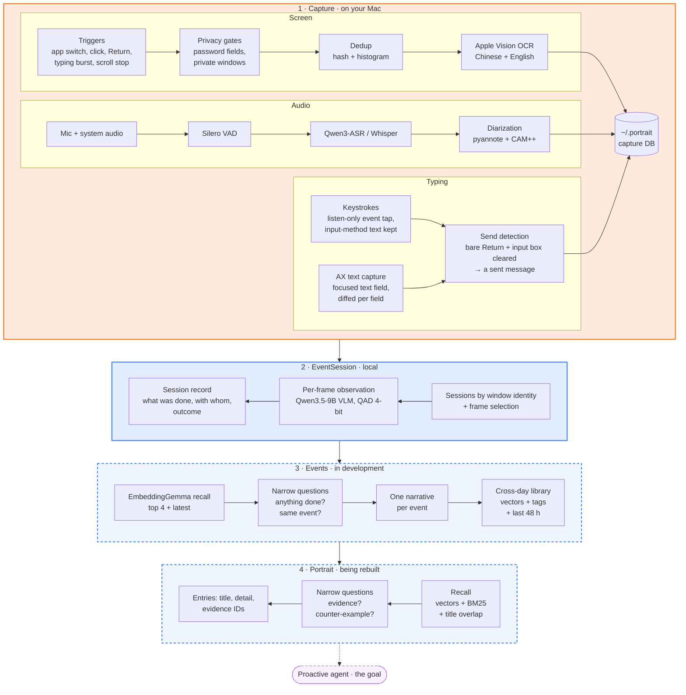

<div align="center">
  

  <h1>My Portrait</h1>

  <p><b>A long-term digital portrait of you, built on your Mac.</b></p>

  <p>It quietly captures your screen, voice, and keystrokes, and over months and years distills them into a portrait of you — what you work on, who you spend time with, what you can do, and how you decide. <b>Everything stays on your Mac.</b></p>

  <a href="https://github.com/joyzhang14-14/My-Portrait/releases/latest">
    
  </a>
</div>

---

## How it works



Solid boxes run in the app today; dashed boxes are in development.

## The Neural Graph

As My Portrait keeps running, the events it finds grow into a graph that belongs only to you.

<div align="center">
  <br/>
  <sub>The event graph, played back over time.</sub>
</div>

## Install

1. Download the `.dmg` from [the latest release](https://github.com/joyzhang14-14/My-Portrait/releases/latest).
2. The app is self-signed, so Gatekeeper will block it. Pick one:

   **Option A — strip quarantine (no prompts):**

   ```bash
   xattr -dr com.apple.quarantine ~/Downloads/MyPortrait_*.dmg
   ```

   Open the DMG, drag **My Portrait** into `Applications` — first launch just works.

   **Option B — approve once:**
   Open the DMG, drag into `Applications`, then **right-click the app → Open → Open** in the warning dialog.

> **Requires an Apple silicon Mac with 16 GB of memory, on macOS 15 or later.** Updates ship automatically via [Sparkle](https://sparkle-project.org).

## Where it's going

**The capture system is fully local.** Screen OCR, audio transcription and speaker diarization all run on your Mac. Keystrokes / AX (macOS accessibility APIs — what you actually typed) never leave it either.

**Session understanding is local too.** A Qwen3.5-9B vision-language model, distilled and quantized to 4 bits, turns each working session into a structured record on your Mac while it is charging and idle.

**Two layers are still in progress:** merging sessions into events across days (research code in [`research/event-merge`](research/event-merge)), and the portrait, which is being rebuilt. Until they run locally, these call a cloud LLM with your own API key.

## Our Goal

The goal is a **proactive agent** that knows you well enough to act for you: it suggests, plans and does things in the way you would. It stands on a digital portrait that keeps growing with you for years, built with **no cloud API at all** — your data **never** leaves your device: every step, end to end, on an Apple silicon Mac with 16 GB of memory. Work in progress toward that:

- local models sized to fit 16 GB alongside everything else that's running (the session layer already runs this way);
- telling apart what was merely _on screen_ from what you were actually _doing_;
- keeping the portrait anchored to real evidence instead of inventing the missing parts.

## Acknowledgements

My Portrait's screen capture, audio capture, and timeline all draw on the approach worked out by **[screenpipe](https://github.com/mediar-ai/screenpipe)** — how to record continuously in the background without getting in the way, and how to turn a day of raw activity into something you can scroll back through. Huge thanks to Louis Beaumont and the mediar-ai team for working that out in the open — go take a look at what they're building.

## Credits

- **[screenpipe](https://github.com/mediar-ai/screenpipe)** — screen capture, audio capture, and timeline approach.
- **[WhisperKit](https://github.com/argmaxinc/WhisperKit)** · **[Qwen3-ASR](https://github.com/ivan-digital/qwen3-asr-swift)** · **[mlx-swift](https://github.com/ml-explore/mlx-swift)** · **[GRDB](https://github.com/groue/GRDB.swift)** — on-device AI on macOS, made practical.

---

<div align="center">
  <sub>Building from source or contributing? See <a href="DEVELOPER.md">DEVELOPER.md</a>.</sub>
</div>
